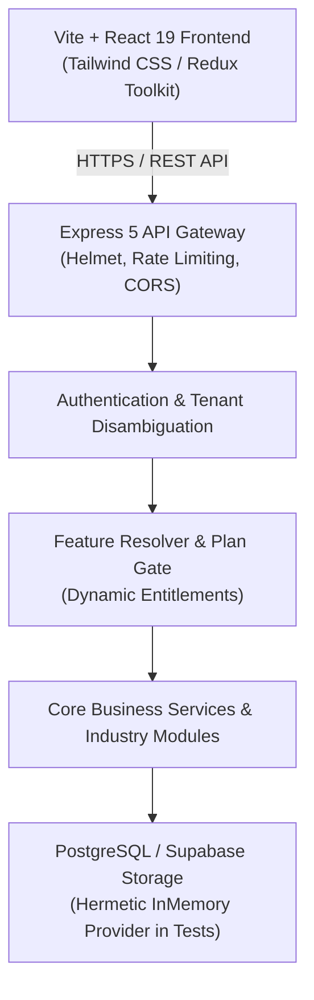

# Universal SaaS POS + ERP — System Architecture

## 1. Overview & Vision
The Universal SaaS POS + ERP Platform is an enterprise-grade multi-tenant platform designed to support diverse commercial verticals—including retail shops, supermarkets, restaurants, electronic service centers, beauty salons, and professional service organizations—from a single unified codebase.



---

## 2. Architectural Pillars

### A. Strict Multi-Tenant Logical Data Isolation
- **Trusted Server-Side Context**: The backend never trusts a `tenant_id` supplied in request bodies, query strings, or headers by clients.
- **JWT Identity Token**: All authenticated requests carry an encrypted/signed JWT identifying `userId` and `tenantId`.
- **Tenant Middleware**: Resolves the tenant from the database, checks tenant operational status (`ACTIVE`, `TRIAL`, `SUSPENDED`, etc.), and attaches the verified tenant context to `req.tenant`.
- **Database Partitioning**: All queries executed against PostgreSQL or Supabase query builders enforce `.eq('tenant_id', req.tenant.id)`.

### B. Decimal-Safe Monetary Calculation Layer
Floating-point calculations (e.g. `0.1 + 0.2 = 0.30000000000000004`) are prohibited for financial calculations across POS checkout, invoices, purchase orders, taxes, discounts, and payroll:
- All financial calculations pass through `shared/utils/decimal.js`.
- Internal precision handles minor units (cents) and rounds authoritatively using round-half-up.
- Backend ignores client-provided subtotals and totals, re-computing line items directly from product unit prices, quantities, and discount rates.

### C. Concurrency-Safe Transactional Workflows
- **Idempotency Keys**: POS checkout requests accept an `Idempotency-Key` HTTP header. Duplicate requests return the original sale result without double-charging or deducting duplicate inventory.
- **Atomic Stock Checks**: Inventory balances are validated before sales are confirmed. Requests attempting to oversell products with insufficient inventory are rejected with HTTP 400.
- **Refunds & Restock**: Returns and refund workflows restore inventory stock balances and log an audit trail in `inventory_logs`.

---

## 3. Technology Stack

### Frontend
- **Framework**: React 19 + Vite 8
- **State Management**: Redux Toolkit (auth, cart, tenant state)
- **Routing**: React Router v7 with protected routes and dynamic `PlanGate` component
- **Styling**: Modern CSS variables and utility classes
- **Networking**: Axios instance with automatic JWT bearer token injection

### Backend
- **Runtime**: Node.js 20+
- **Server Framework**: Express 5
- **Security**: Helmet, Express Rate Limiter, CORS with origin whitelisting, PBKDF2 with salt password hashing
- **Testing**: Node.js built-in test runner (`node:test`, `node:assert`, `supertest`) with 53 comprehensive integration tests

### Database & Persistence
- **Primary Database**: PostgreSQL (via Supabase client)
- **Hermetic Testing Provider**: `inMemoryDb.js` providing full in-memory table store, query builder filtering, upsert, and ordering without external network dependencies.
- **Object Storage**: Supabase Storage for receipts, logos, and invoices.

---

## 4. Module Directory Structure
```
├── client/
│   ├── src/
│   │   ├── components/      # UI components (pos, layout, common)
│   │   ├── pages/           # Dashboard and Super Admin pages
│   │   ├── services/        # Frontend API connectors
│   │   ├── store/           # Redux Toolkit slices
│   │   └── routes/          # Protected and Plan-gated routing
├── server/
│   ├── src/
│   │   ├── config/          # Database and CORS configuration
│   │   ├── controllers/     # REST route controllers
│   │   ├── middlewares/     # Auth, Tenant, Plan Gate, Rate Limit, Error handling
│   │   ├── modules/         # Specialized Industry Modules
│   │   │   ├── restaurant/  # Tables, KDS, kitchen orders
│   │   │   ├── repairs/     # Job cards, diagnostic notes, spare parts
│   │   │   ├── salon/       # Stylists, services, booking conflict prevention
│   │   │   └── hrm/         # Staff directory, attendance, payroll
│   │   ├── routes/          # Express route definitions
│   │   ├── services/        # Authoritative business logic
│   │   └── utils/           # Password hashing, feature resolver, totals calculation
│   └── tests/               # 5 test suites (Phases 1-5, 53 tests)
└── shared/
    ├── constants/           # Master Feature Registry & Industry Presets
    └── utils/               # Decimal-safe arithmetic engine
```

