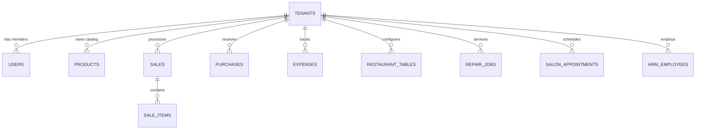

# Universal SaaS POS + ERP — Database Schema & Data Dictionary

## 1. Relational Entity Overview

The platform uses a relational schema designed for PostgreSQL / Supabase with strict foreign keys and tenant isolation columns (`tenant_id`).

---

## 2. Platform Core & Multi-Tenant Tables

### `tenants`
The root multi-tenant entity representing a registered business workspace.
- `id` (VARCHAR / UUID, PRIMARY KEY): Unique identifier.
- `name` (VARCHAR, NOT NULL): Legal business name.
- `slug` (VARCHAR, UNIQUE): Unique URL identifier.
- `email` (VARCHAR, NOT NULL): Primary tenant contact email.
- `plan` (VARCHAR, DEFAULT 'starter'): Plan tier (`starter`, `pro`, `enterprise`).
- `status` (VARCHAR, DEFAULT 'trial'): Operational state (`trial`, `active`, `past_due`, `suspended`, `cancelled`, `expired`, `archived`).
- `feature_overrides` (JSONB, DEFAULT '{}'): Per-tenant feature enablement overrides.
- `max_users` (INTEGER, DEFAULT 2): Allowed active users quota.
- `max_branches` (INTEGER, DEFAULT 1): Allowed business branches quota.
- `max_products` (INTEGER, DEFAULT 100): Allowed product catalog size.
- `trial_ends_at` (TIMESTAMP): Expiry timestamp for trial accounts.
- `created_at` (TIMESTAMP): Creation date.

### `super_admins`
Platform operator accounts with access to the Super Admin control center.
- `id` (VARCHAR / UUID, PRIMARY KEY)
- `email` (VARCHAR, UNIQUE, NOT NULL)
- `password` (VARCHAR, NOT NULL): PBKDF2/bcrypt salted password hash.
- `role` (VARCHAR, DEFAULT 'superadmin')
- `created_at` (TIMESTAMP)

### `users`
Tenant employees, cashiers, technicians, and store administrators.
- `id` (VARCHAR / UUID, PRIMARY KEY)
- `tenant_id` (VARCHAR / UUID, REFERENCES tenants(id), NOT NULL)
- `name` (VARCHAR, NOT NULL)
- `email` (VARCHAR, NOT NULL): Email address (uniqueness scoped with tenant).
- `password` (VARCHAR, NOT NULL): Salted password hash.
- `role` (VARCHAR, DEFAULT 'cashier'): (`admin`, `manager`, `cashier`, `technician`, `stylist`).
- `branch_id` (VARCHAR, NULLABLE): Assigned primary location.
- `created_at` (TIMESTAMP)

### `business_locations` (Branches)
Multi-location outlets operated under a single business tenant.
- `id` (VARCHAR / UUID, PRIMARY KEY)
- `tenant_id` (VARCHAR / UUID, REFERENCES tenants(id), NOT NULL)
- `name` (VARCHAR, NOT NULL): Branch name (e.g. "Main Branch", "Colombo Mall").
- `code` (VARCHAR): Unique store code (e.g. "HQ", "B-02").
- `address` (TEXT)
- `phone` (VARCHAR)
- `is_primary` (BOOLEAN, DEFAULT FALSE)
- `status` (VARCHAR, DEFAULT 'active')
- `created_at` (TIMESTAMP)

---

## 3. Product & Inventory Tables

### `categories`
- `id` (VARCHAR / UUID, PRIMARY KEY)
- `tenant_id` (VARCHAR / UUID, REFERENCES tenants(id), NOT NULL)
- `name` (VARCHAR, NOT NULL)
- `created_at` (TIMESTAMP)

### `products`
- `id` (VARCHAR / UUID, PRIMARY KEY)
- `tenant_id` (VARCHAR / UUID, REFERENCES tenants(id), NOT NULL)
- `category_id` (VARCHAR / UUID, REFERENCES categories(id))
- `name` (VARCHAR, NOT NULL)
- `sku` (VARCHAR, NOT NULL)
- `barcode` (VARCHAR, NULLABLE)
- `price` (NUMERIC(12, 2), NOT NULL): Selling unit price.
- `cost` (NUMERIC(12, 2), DEFAULT 0): Purchasing unit cost.
- `stock` (NUMERIC(12, 3), DEFAULT 0): Available stock quantity.
- `min_stock_alert` (INTEGER, DEFAULT 5): Reorder warning threshold.
- `created_at` (TIMESTAMP)

### `inventory_logs`
Audit ledger for stock movements.
- `id` (VARCHAR / UUID, PRIMARY KEY)
- `tenant_id` (VARCHAR / UUID, REFERENCES tenants(id), NOT NULL)
- `product_id` (VARCHAR / UUID, REFERENCES products(id), NOT NULL)
- `type` (VARCHAR): (`sale`, `purchase_grn`, `refund`, `adjust`, `repair_consumed`).
- `delta` (NUMERIC(12, 3), NOT NULL): Quantity change (positive or negative).
- `reference_id` (VARCHAR, NULLABLE): Associated sale, purchase, or repair job ID.
- `note` (TEXT)
- `created_at` (TIMESTAMP)

---

## 4. Sales & POS Checkout Tables

### `sales`
- `id` (VARCHAR / UUID, PRIMARY KEY)
- `tenant_id` (VARCHAR / UUID, REFERENCES tenants(id), NOT NULL)
- `invoice_number` (VARCHAR, NOT NULL)
- `customer_id` (VARCHAR / UUID, NULLABLE)
- `customer_name` (VARCHAR, DEFAULT 'Walk-in Customer')
- `subtotal` (NUMERIC(12, 2), NOT NULL)
- `tax_total` (NUMERIC(12, 2), DEFAULT 0)
- `discount_total` (NUMERIC(12, 2), DEFAULT 0)
- `total` (NUMERIC(12, 2), NOT NULL)
- `payment_method` (VARCHAR): (`cash`, `card`, `split`, `credit`).
- `status` (VARCHAR, DEFAULT 'completed'): (`completed`, `refunded`, `partially_refunded`, `voided`).
- `user_id` (VARCHAR / UUID, NULLABLE): Cashier who processed transaction.
- `created_at` (TIMESTAMP)

### `sale_items`
- `id` (VARCHAR / UUID, PRIMARY KEY)
- `sale_id` (VARCHAR / UUID, REFERENCES sales(id), NOT NULL)
- `tenant_id` (VARCHAR / UUID, REFERENCES tenants(id), NOT NULL)
- `product_id` (VARCHAR / UUID, REFERENCES products(id), NOT NULL)
- `name` (VARCHAR, NOT NULL)
- `price` (NUMERIC(12, 2), NOT NULL)
- `quantity` (NUMERIC(12, 3), NOT NULL)
- `total_amount` (NUMERIC(12, 2), NOT NULL)

### `payments`
Detailed payment transactions supporting split cash/card payments.
- `id` (VARCHAR / UUID, PRIMARY KEY)
- `sale_id` (VARCHAR / UUID, REFERENCES sales(id), NOT NULL)
- `tenant_id` (VARCHAR / UUID, REFERENCES tenants(id), NOT NULL)
- `payment_method` (VARCHAR, NOT NULL): (`cash`, `card`, `bank_transfer`).
- `amount` (NUMERIC(12, 2), NOT NULL)
- `created_at` (TIMESTAMP)

### `idempotency_keys`
- `id` (VARCHAR / UUID, PRIMARY KEY)
- `tenant_id` (VARCHAR / UUID, REFERENCES tenants(id), NOT NULL)
- `idempotency_key` (VARCHAR, NOT NULL)
- `response_payload` (JSONB, NOT NULL)
- `created_at` (TIMESTAMP)

---

## 5. Procurement & Finance Tables

### `suppliers`
- `id` (VARCHAR / UUID, PRIMARY KEY)
- `tenant_id` (VARCHAR / UUID, REFERENCES tenants(id), NOT NULL)
- `name` (VARCHAR, NOT NULL)
- `phone` (VARCHAR)
- `email` (VARCHAR)
- `address` (TEXT)
- `created_at` (TIMESTAMP)

### `purchases` (Goods Received Notes - GRN)
- `id` (VARCHAR / UUID, PRIMARY KEY)
- `tenant_id` (VARCHAR / UUID, REFERENCES tenants(id), NOT NULL)
- `supplier_id` (VARCHAR / UUID, REFERENCES suppliers(id))
- `supplier_name` (VARCHAR)
- `total_cost` (NUMERIC(12, 2), NOT NULL)
- `status` (VARCHAR, DEFAULT 'received')
- `items` (JSONB, NOT NULL)
- `created_at` (TIMESTAMP)

### `expenses`
- `id` (VARCHAR / UUID, PRIMARY KEY)
- `tenant_id` (VARCHAR / UUID, REFERENCES tenants(id), NOT NULL)
- `category` (VARCHAR, NOT NULL): (`Rent`, `Utilities`, `Salaries`, `Maintenance`, `General`).
- `amount` (NUMERIC(12, 2), NOT NULL)
- `note` (TEXT)
- `date` (DATE, NOT NULL)
- `created_at` (TIMESTAMP)

---

## 6. Industry Specialized Tables

### `restaurant_tables` & `restaurant_orders`
- `restaurant_tables`: `id`, `tenant_id`, `table_number`, `capacity`, `floor`, `status` (`available`, `occupied`, `reserved`).
- `restaurant_orders`: `id`, `tenant_id`, `table_id`, `table_number`, `waiter_name`, `items` (JSONB), `total`, `status` (`placed`, `preparing`, `ready`, `served`, `paid`, `cancelled`).

### `repair_jobs`
- `id`, `tenant_id`, `customer_name`, `customer_phone`, `device_model`, `serial_number`, `problem_description`, `technician_name`, `status` (`received`, `repairing`, `completed`, `delivered`), `labor_cost`, `parts_cost`, `total_cost`, `spare_parts` (JSONB).

### `salon_services`, `salon_stylists`, `salon_appointments`
- `salon_services`: `id`, `tenant_id`, `name`, `duration_minutes`, `price`.
- `salon_stylists`: `id`, `tenant_id`, `name`, `specialization`, `phone`, `status`.
- `salon_appointments`: `id`, `tenant_id`, `customer_name`, `customer_phone`, `stylist_id`, `stylist_name`, `service_id`, `service_name`, `appointment_date`, `appointment_time`, `duration_minutes`, `price`, `status` (`confirmed`, `in_progress`, `completed`, `cancelled`).

### `hrm_employees`, `hrm_attendance`, `hrm_payroll`
- `hrm_employees`: `id`, `tenant_id`, `name`, `role`, `department`, `salary_amount`, `phone`, `email`, `status`.
- `hrm_attendance`: `id`, `tenant_id`, `employee_id`, `employee_name`, `date`, `check_in`, `check_out`, `status` (`present`, `absent`, `late`, `half_day`).
- `hrm_payroll`: `id`, `tenant_id`, `employee_id`, `employee_name`, `month_year`, `base_salary`, `bonus`, `deductions`, `net_salary`, `status` (`draft`, `paid`), `payment_date`.

