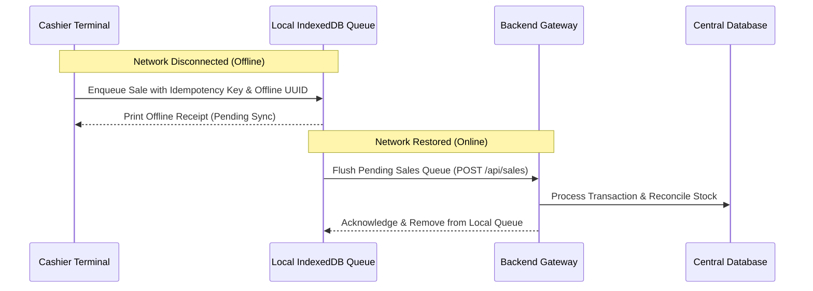

# Universal SaaS POS + ERP — Offline POS & Sync Architecture

## 1. Architectural Strategy

In retail and hospitality environments, internet connectivity can be intermittent. The platform provides an offline-resilient POS architecture ensuring cashiers can continue checkout operations without disruption during network outages.

---

## 2. Core Implementation Elements

### A. Local Catalog Caching
- Upon initial login and periodic heartbeat, the client synchronizes the product catalog (SKUs, barcodes, unit prices, tax rates) into local browser storage (`IndexedDB`).
- Search and barcode lookups execute instantaneously against the local catalog index.

### B. Transaction Idempotency & Queue
- When offline, each transaction is tagged with a client-generated UUID as its `Idempotency-Key` and stored in the `offline_transactions` IndexedDB object store.
- Cash receipts indicate "Offline Mode - Pending Sync".

### C. Background Synchronization & Replay
- When network connectivity is restored (`navigator.onLine` event or successful health check to `/health`), the sync worker dequeues transactions sequentially.
- The backend verifies that the stock deduction is applied. If inventory is depleted during the offline window, the sale is recorded and an inventory negative variance warning is flagged for manager review rather than losing customer payment records.

