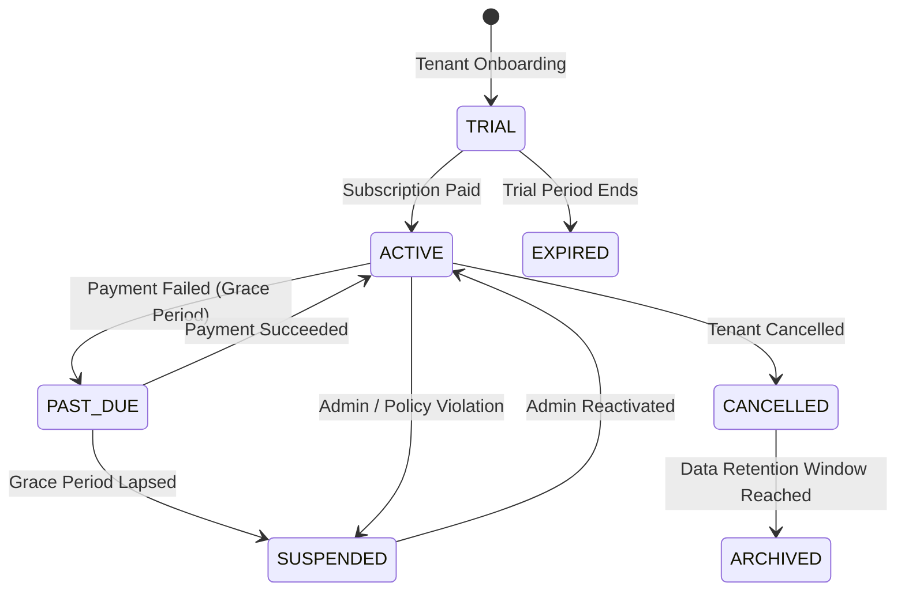

# Universal SaaS POS + ERP — Subscription System & Lifecycle Management

## 1. SaaS Subscription Plans

The platform provides 3 standard pricing tiers with configurable resource quotas:

| Metric / Feature | Starter Plan | Professional Plan | Enterprise Plan |
| :--- | :--- | :--- | :--- |
| **Target Audience** | Micro-merchants, kiosks | High-volume retail stores | Multi-branch chains, hotels |
| **Monthly Pricing** | \$19.00 / month | \$49.00 / month | \$129.00 / month |
| **Max Users** | 2 users | 5 users | Unlimited / 50+ |
| **Max Branches** | 1 location | 2 locations | 10+ locations |
| **Max Products** | 100 products | 2,500 products | Unlimited |
| **Purchasing & GRN**| ❌ Disabled | ✅ Included | ✅ Included |
| **Advanced Reports**| Basic | ✅ Included | ✅ Comprehensive |
| **Industry Modules**| ❌ Disabled | Optional add-on | ✅ Included (Restaurant, Repairs, Salon, HRM) |

---

## 2. Business Operational Lifecycle States

Every tenant business workspace maintains an operational lifecycle state machine:

### State Behaviors
- **`TRIAL`**: Access to all plan features until `trial_ends_at`. When current timestamp > `trial_ends_at`, the tenant middleware automatically blocks access.
- **`ACTIVE`**: Full read/write operational access within plan quotas.
- **`PAST_DUE`**: Configurable grace period (e.g. 7 days). Alert banner shown to store managers.
- **`SUSPENDED`**: Operational writes and checkouts are blocked immediately with HTTP 403.
- **`CANCELLED`**: Read-only historical data access for end-of-year tax review.
- **`EXPIRED`**: Checkout and transactional APIs blocked until a plan renewal is registered.
- **`ARCHIVED`**: Tenant account disabled and placed in cold storage.

---

## 3. Quota & Limits Enforcement

Quotas are enforced by server-side services before committing writes:
- **Users Quota**: `userService.createUser` counts active tenant users. If `count >= tenant.max_users`, returns HTTP 400 with `Maximum user limit reached for your plan`.
- **Products Quota**: `productService.createProduct` counts tenant products. If `count >= tenant.max_products`, returns HTTP 400.
- **Branches Quota**: `branchService.createBranch` counts tenant locations. If `count >= tenant.max_branches`, returns HTTP 400.

